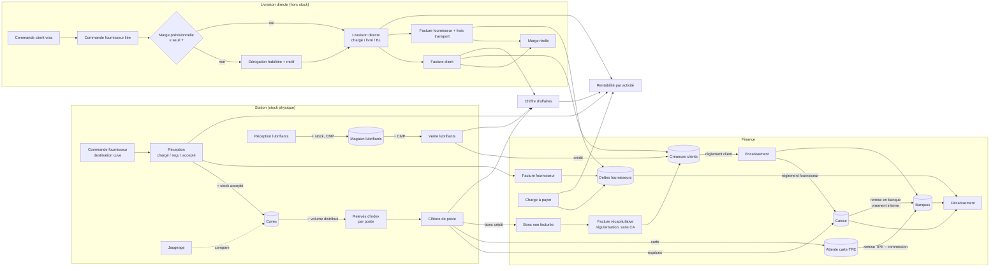
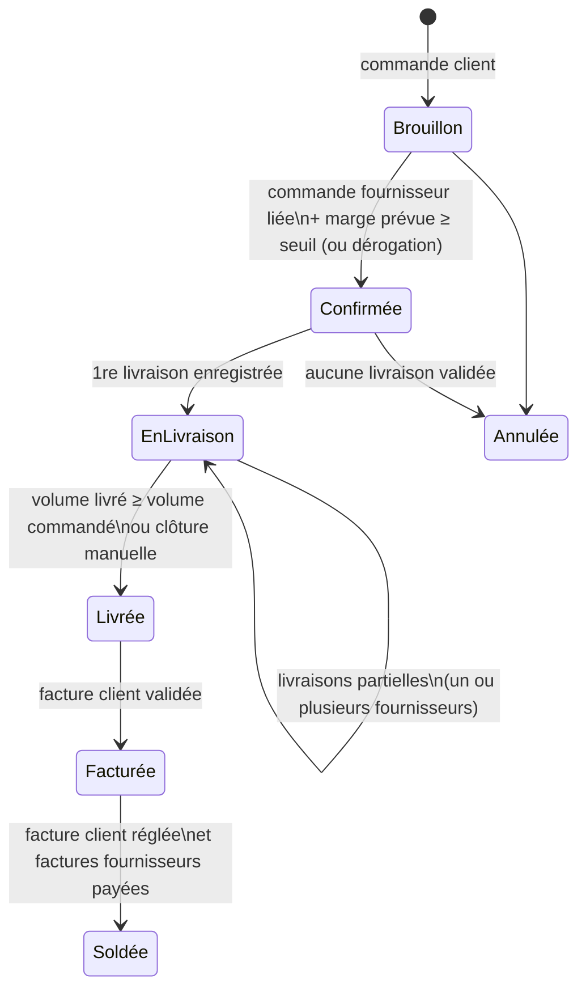
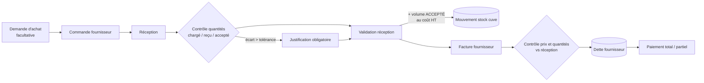
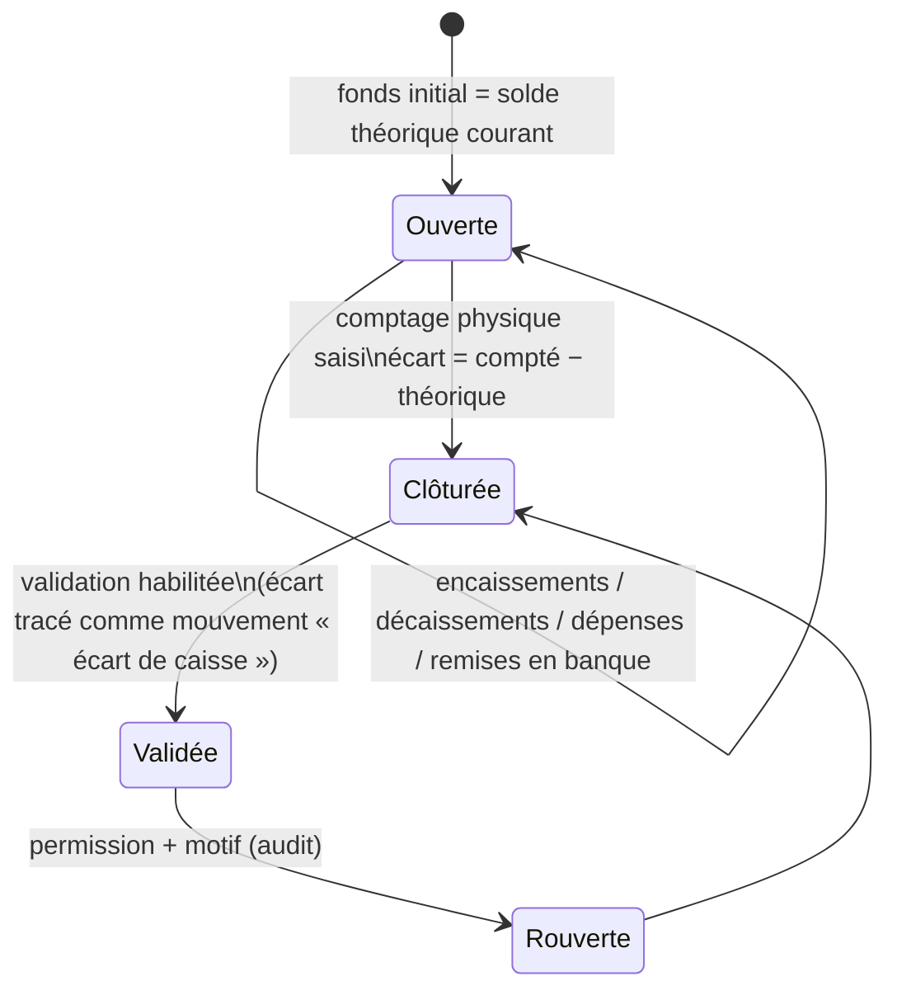
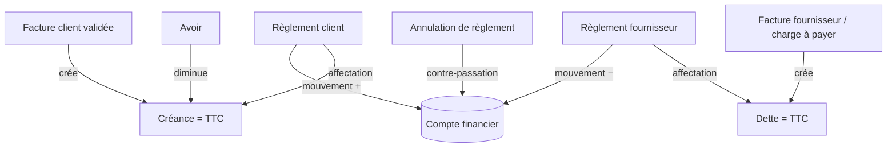
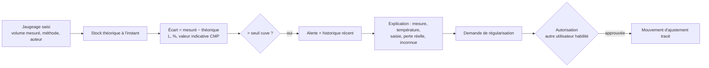

# SSI — 02. Flux métier

Les diagrammes sont au format Mermaid (lisibles dans GitHub, VS Code et la plupart des visionneuses Markdown).

## 1. Carte générale des flux



Règle structurante : **seules trois sources créent du chiffre d'affaires** :

1. Les relevés d'index validés (carburant vendu en station) ;
2. Les ventes d'articles validées (lubrifiants, produits annexes) ;
3. Les factures clients de livraisons directes (vrac), diminuées des avoirs.

Les règlements, les bons de crédit à la pompe et la facture récapitulative de ces bons **ne créent jamais** de chiffre d'affaires : ils ventilent ou recouvrent un CA déjà constaté.

## 2. Poste de travail et relevés d'index (vente par index)

```mermaid
sequenceDiagram
    actor P as Pompiste / Resp. station
    participant API as SSI API
    participant DB as PostgreSQL
    P->>API: Ouvrir poste (date, responsable)
    API->>DB: poste OUVERT ; index de début proposés = index de fin précédents
    loop Pour chaque pistolet
        P->>API: Saisir index fin (+ opérateur)
        API->>API: Contrôles : fin ≥ début, continuité, doublon, volume inhabituel
        API->>DB: relevé SAISI (prix applicable figé)
    end
    P->>API: Saisir règlements du poste (espèces, carte, bons crédit, chèques…)
    P->>API: Clôturer le poste
    API->>API: Volumes, montants théoriques, écarts par mode, par opérateur
    API->>DB: poste CLÔTURÉ (rapport d'écarts)
    actor R as Responsable caisse
    R->>API: Valider la clôture (Idempotency-Key)
    API->>DB: TRANSACTION : relevés VALIDÉS ; mouvements de stock (− cuve) ;<br/>mouvements financiers (caisse, TPE, chèques) ; bons crédit enregistrés ;<br/>écart de poste tracé ; audit
    Note over API,DB: Réouverture = permission + motif, auditée, contre-passations
```

États d'un poste : `Ouvert → Clôturé → Validé` ; `Validé → Rouvert` (autorisé, motif) qui contre-passe les mouvements générés puis revient à `Clôturé`.

Exclusivité vente par index / transactions individuelles : pour le carburant, SSI v1 applique la **vente par index** (hypothèse H-01). Les transactions individuelles (bons de crédit, paiements carte) sont saisies comme **ventilation des règlements du poste**, rattachées au même volume. Elles ne peuvent pas créer de vente distincte.

## 3. Livraison directe en vrac



Calcul de marge par livraison :

* **Prévue** (à la confirmation) : volume × (prix vente HT − prix achat HT) − frais prévus.
* **Réelle** : CA facturé HT net − (coût d'achat facturé HT + frais directs répartis HT). Statut `Provisoire` tant qu'il manque la facture fournisseur, la facture client ou un frais attendu ; les éléments manquants sont listés.

Aucune écriture de stock n'est générée à aucune étape.

## 4. Achat carburant pour les cuves



Le coût d'entrée en stock est le prix de commande HT ; à la validation de la facture, l'écart de prix éventuel est enregistré comme ajustement de valeur (hypothèse H-07).

## 5. Caisse



## 6. Règlements, créances et dettes



Créance d'une facture = TTC − Σ affectations − Σ avoirs imputés. Aucun champ « solde » n'est saisi.

## 7. Jaugeage et écart de stock



Le stock n'est jamais modifié automatiquement pour faire disparaître un écart.
